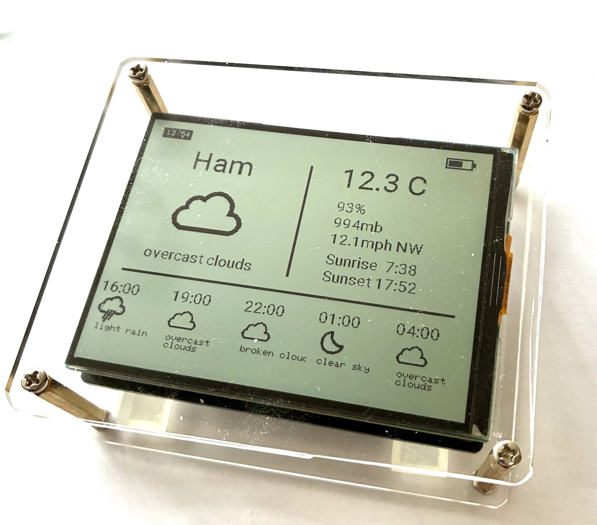
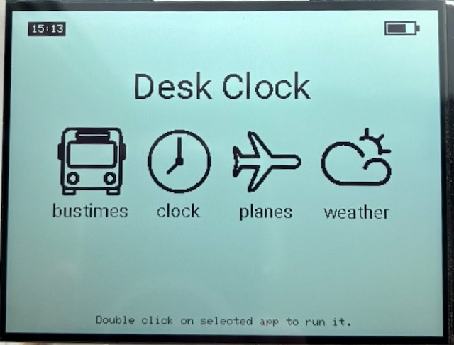
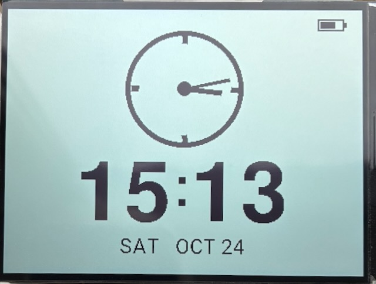
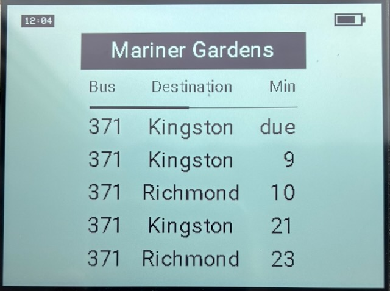
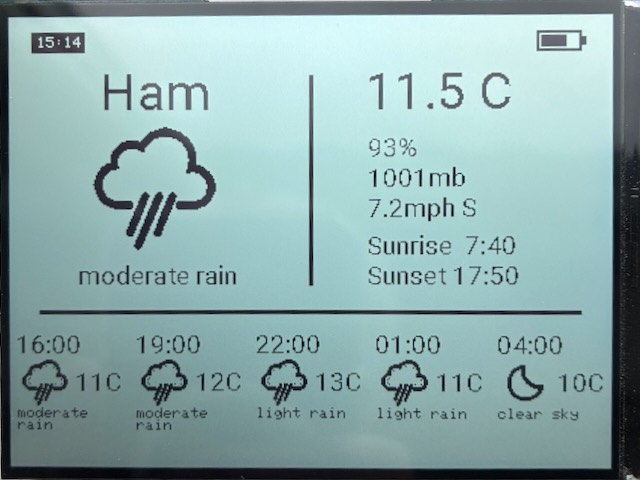
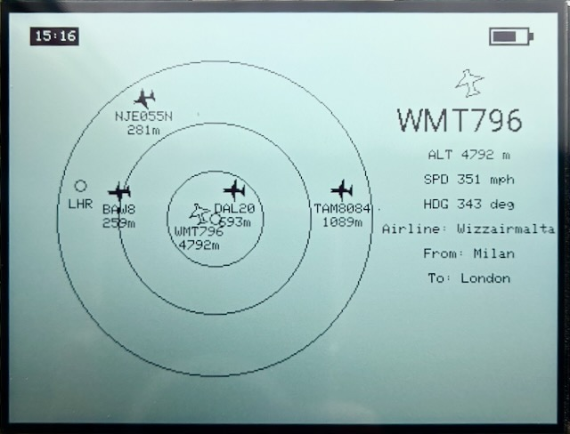

# micropython-waveshare-ESP32-S3-RLCD-4.2
Micropython based software for Waveshare's ESP32-S3-RLCD-4.2. Includes micropython driver for the ST7305 based 4.2 inch reflective LCD.




**Note:** The refective LCD screen is quite fragile - I dropped my initial device a few inches onto a hard surface and it wrecked the screen - black splodges and random lines. I put the next one I bought into a protective enclosure made from clear perspex and brass spacers as pictured above. 


## Application Modules
The software contains the set of **apps** outlined below with screenshots. These apps are simply micropython modules that provide an `app_init()`and an `app_end()` method.The apps are supported by a version of **tempos** so installing a new app is simply a matter of copying it into the **apps** directory.  A full decription of **tempos** can be found in the repository `jeffmer/TTGO-T-watch-2020-Micropython-OS`. 

### Finder ###
<p align="center">
  
</p>

This version of Tempos has a finder with an icon for each app. Apps are selected using the **key** - leftmost - button and an app is entered by double clicking the key button. A single click exits apps and returns to the finder screen. An icon for each app is located in the ```images/icons``` directory and is a 64x 64 RGB  png image with the background set to white ```0xFFFFFF```. An icon must have the same name as the app i.e. ```appname.png```.

### Clock app
<p align="center">
  
</p>

Simple clock display - to keep time accurate across  ```lightsleep```  **tempos** synchronises RTC time with the PCF80563 real-time clock module every ten minutes.

### Bustimes app
<p align="center">
  
</p>

This uses the Transport for London API to display bus arrival times at a named busstop. To configure it for your local busstop you need to know its NaPTAN Id. The simplest way to find this for your stop is simply to ask Google/Gemini. The app is currently configured to display buses for two directions (North and South). This will not work for all bus stops and you may need to hack the code to display only one direction.

### Weather app
<p align="center">
  
</p>

This uses OpenWeather's free API to display the current weather and three hour forecast for a particular loaction. The GPS coordinates of your location together with your OpenWeather API key should be entered into the ```config.py``` file. 

### Planes app

<p align="center">
  
</p>

The app uses the free OpenSky API to display current aircraft positions in your vicinity. The details of your OpenSky account together with the location of your nerarest airport - mine is Heathrow - are entered into ```config.py```. The size of the local vicinity displayed is determined by the constant ```RADIUS``` - number of nautical miles - defined in ```config.py```.

## Power saving

To extend battery life the event scheduler puts the esp32 S3 into lightsleep if there is nothing scheduled to happen in the next ten seconds or more. This reduces current to just under 10ma meaning that a typical 186250 lithium ion cell ( 2600maH ) should last over a week. This depends on the app left running. Both the **bustimes** and **planes** apps do not permit light sleep and so they will use up the batttery in a day or so if left running.

Lightsleep on the ESP32 S3 has two rather negative consequences. The first is that when lightsleep is entered the clock that drives the internal USB driver is stopped and it not re-started on exit from ligtsleep. This cannot be fixed in micropython and needs ESP32 SDK changes. The result is that to install and debug new apps it is best to disable power saving by setting ```POWER_SAVE``` to ```False``` in ```config.py```.

The second is that  when the user button or **key** is pressed it usually has to wakeup the esp32 S3 from lightsleep before activating a finder function. If the button is held down for too long it causes a watchdog timeout and susequent reboot. I have not found a way to change this behaviour yet, so stick to short clicks.


## ST7305 driver

This is written enirely in Micropython and takes 11ms to display a 400x300 pixel ```Framebuffer```. The driver is a subclass of a ```Graphics``` class which wraps the underlying ```Framebuffer``` primitives to allow partial updates of the screen buffer and to add some functionality such as polygon rotation, fonts and wrapped text. 
I based the driver on the micropython ST7302 driver from the github repository at **elulis/micropython_ST7302**. 


## Installation

The current standard Micropython firmware disables all GPIO pins during lightsleep. This has the unfortunate effect of blanking the display. This rather defeats the purpose of the low power reflective LCD screen which should be always on. Consequently, I include in the ```firmware``` a slightly modified firmware which does not change the state of GPIO pins during light sleep. It can easly be flashed using **Thonny**. The easiest way to install the micropython files is to copy the entire ```src``` directory to the root of the device again using **Thonny**. Note that the ```config.py``` file needs to updated with your wifi details etc. 

To subsequently reconnect the board to a host computer using USB, first power it  down by long pressing the middle power button. Then hold down the leftmost user button while connecting the USB cable. Then blip the power button to reboot the board and click the red soft reset button on Thonny while continuing to hold down the user button. It may be easier to remove the battery - with no battery there is no need to blip the power button but the user button does need to be held down.


